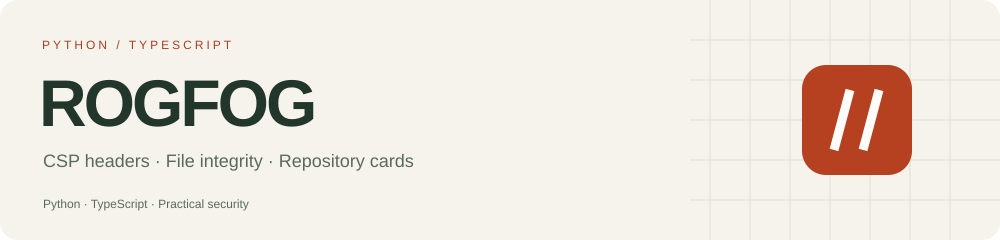
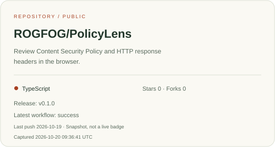
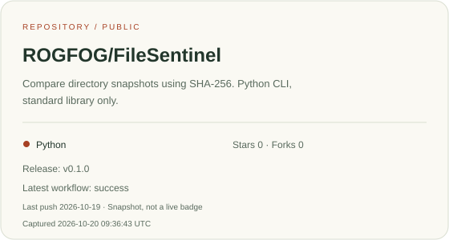
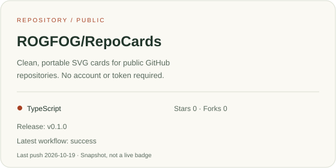

I'm interested in application security, developer tools, and making technical
ideas easier to inspect. Here are a few small projects built around those interests.

### Security workbench

**PolicyLens** — read Content Security Policy and HTTP security headers with
contextual explanations. Processing stays in the browser.
[Try the workbench](https://rogfog.github.io/PolicyLens/) · [Code and design notes](https://github.com/ROGFOG/PolicyLens)

### File integrity

**FileSentinel** — create SHA-256 snapshots and compare changes to a directory.
Python, standard library only, with explicit scan scope and error handling.
[Quick start](https://github.com/ROGFOG/FileSentinel#quick-start)

### Project presentation

**RepoCards** — turn public GitHub repository data into portable SVG cards.
The cards above use its renderer.
[Make a card](https://rogfog.github.io/RepoCards/) · [Source](https://github.com/ROGFOG/RepoCards)

---

**How I approach these projects:** clear behavior, repeatable tests, documented
tradeoffs, and small improvements that make the tools more useful. Security
limitations and design decisions are documented alongside the code.

Repository cards are metadata snapshots, not live status badges.
