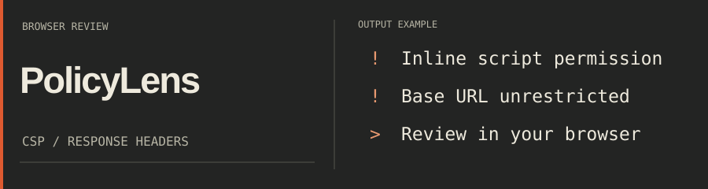
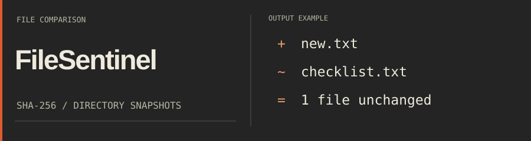
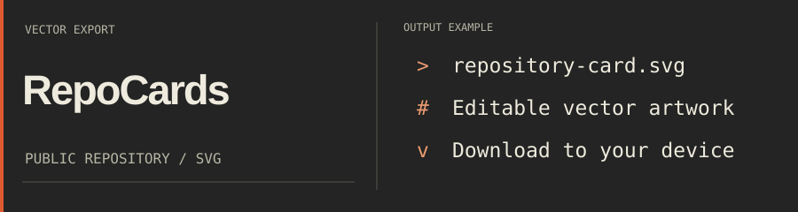

Tools for reviewing security headers, comparing files and presenting repositories.
Built with Python and TypeScript.

## Signal Route

[Play Signal Route](https://rogfog.github.io/ProfileWorkshop/game/) · [How it works](https://rogfog.github.io/ProfileWorkshop/how-it-works.html#game)

## Selected projects

### PolicyLens

Review Content Security Policy and HTTP response headers. Processing stays in your browser.

[Open workbench](https://rogfog.github.io/PolicyLens/)

### FileSentinel

Save a directory's SHA-256 snapshot. Compare it later to find added, removed and changed files. Standard library only.

[Quick start](https://github.com/ROGFOG/FileSentinel#quick-start)

### RepoCards

Turn public GitHub repository metadata into downloadable SVG cards.

[Make a card](https://rogfog.github.io/RepoCards/)

## Build notes

How the header and game work, with instructions for adapting them.

[Explore Profile Workshop](https://rogfog.github.io/ProfileWorkshop/how-it-works.html)

Technical details

Source and implementation notes:

- [Profile Workshop](https://github.com/ROGFOG/ProfileWorkshop)
- [PolicyLens](https://github.com/ROGFOG/PolicyLens)
- [FileSentinel](https://github.com/ROGFOG/FileSentinel)
- [RepoCards](https://github.com/ROGFOG/RepoCards)

## Stack

`Python` · `TypeScript` · `GitHub Actions` · `SVG`

---

[Components & licenses](https://rogfog.github.io/ProfileWorkshop/how-it-works.html#credits)
